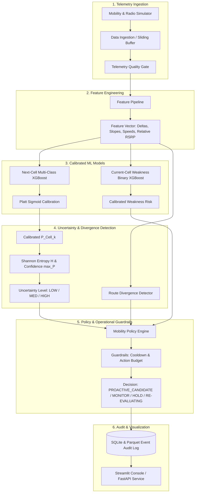
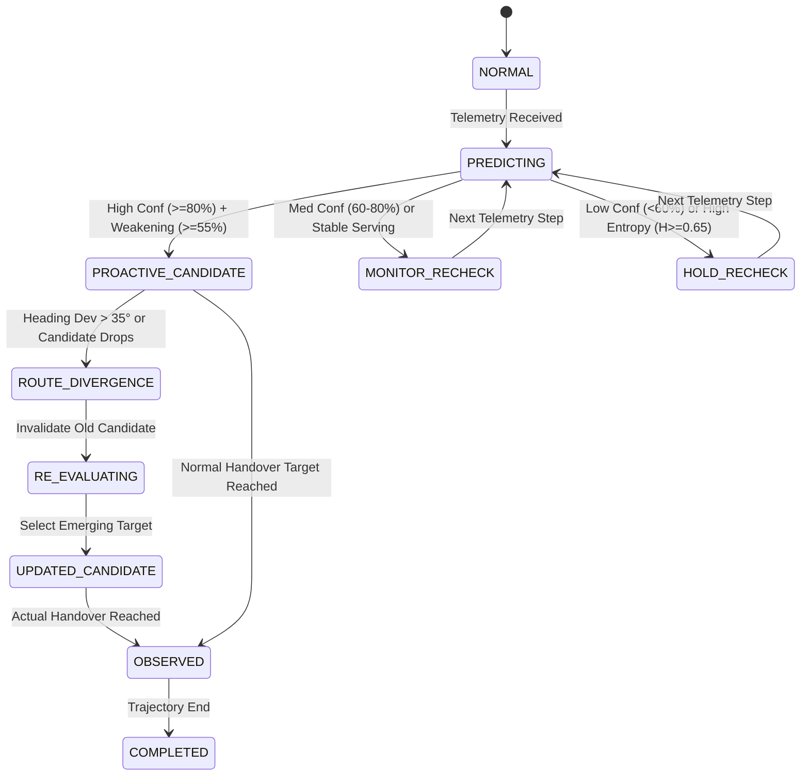

# YellowSense — Architecture & Design Specification
**COMET 5G Spring Board 6 | Problem Statement #6: AI-Native Network Intelligence**

---

## 1. Architectural Philosophy: Strict Separation of Concerns

A core principle of the YellowSense architecture is the explicit decoupling between:
1. **Model** ($\text{Inference} = \text{What is the probability distribution?}$)
2. **Uncertainty** ($\text{Trust} = \text{How reliable and calibrated is this distribution?}$)
3. **Policy** ($\text{Action} = \text{What network operation is safely permitted?}$)
4. **Observation** ($\text{Ground Truth} = \text{What physically transpired?}$)



---

## 2. Mathematical Foundations

### 2.1 3GPP Logarithmic Path Loss & AR(1) Correlated Shadowing
The radio environment simulates realistic cellular RF conditions using 3GPP urban formulations:
$$PL(d) = PL_0 + 10 \gamma \log_{10}(d / d_0) + S(t)$$
Where:
- $PL_0 = 38.5 \text{ dB}$ (Reference attenuation at $1\text{m}$ for $3.5\text{ GHz}$)
- $\gamma = 3.4$ (Path loss exponent)
- $S(t) = \alpha S(t-1) + \sqrt{1 - \alpha^2} \epsilon(t)$, with $\alpha = 0.75$ (Autoregressive correlated log-normal shadowing)

### 2.2 Signal-to-Interference-Plus-Noise Ratio (SINR)
$$\text{SINR}_i = 10 \log_{10} \left( \frac{10^{RSRP_i / 10}}{10^{N_0 / 10} + \sum_{j \neq i} 10^{RSRP_j / 10}} \right)$$
Where $N_0 = -104 \text{ dBm}$ (Thermal noise floor).

### 2.3 Shannon Entropy & Normalized Uncertainty
To capture predictive spread across $K$ candidate base stations:
$$H = -\sum_{k=1}^K P(\text{Cell}_k) \log_2(P(\text{Cell}_k))$$
$$H_{norm} = \frac{H}{\log_2(K)} \in [0.0, 1.0]$$

| Metric | Condition | Operational Policy Meaning |
| :--- | :--- | :--- |
| **LOW Uncertainty** | $H_{norm} < 0.35$ and $\text{Conf} \ge 0.75$ | Strong unimodal consensus; proactive candidate allowed |
| **MEDIUM Uncertainty** | $0.35 \le H_{norm} < 0.65$ | Bi-modal or transition zone; monitor trends |
| **HIGH Uncertainty** | $H_{norm} \ge 0.65$ or $\text{Conf} < 0.60$ | High ambiguity; hold proactive allocation |

---

## 3. Route Divergence Detection Engine

The route divergence detector operates continuously in parallel with the predictive models:

$$\text{Kinematic Discrepancy} = |\theta_{\text{heading}} - \theta_{\text{bearing\_to\_candidate}}|$$
$$\text{RF Gradient Delta} = \frac{d}{dt}(RSRP_{\text{candidate}}) - \frac{d}{dt}(RSRP_{\text{emerging}})$$

When the weighted divergence score exceeds threshold $\tau = 0.55$:
1. The old proactive candidate is immediately **invalidated**.
2. State transitions to `ROUTE_DIVERGENCE` $\to$ `RE_EVALUATING`.
3. Fresh inference is computed, selecting the newly emerging target (`Cell_C`).
4. Operational state updates to `UPDATED_CANDIDATE`.

---

## 4. State Machine Architecture



---

## 5. Future 5G & O-RAN Roadmap

The current POC establishes the foundational ML, uncertainty, and policy intelligence. The evolutionary path towards full carrier deployment comprises six phases:

```
┌─────────────────────────────────────────────────────────────────────────┐
│                    YELLOWSENSE 6-PHASE ROADMAP                         │
├───────────────────┬─────────────────────────────────────────────────────┤
│ Phase 1 (CURRENT) │ Deterministic Multi-Cell Simulation, XGBoost,       │
│                   │ Platt Calibration, Entropy Uncertainty, Streamlit   │
├───────────────────┼─────────────────────────────────────────────────────┤
│ Phase 2           │ Real-Time Streaming Ingestion (Kafka / gRPC / Protobuf)│
├───────────────────┼─────────────────────────────────────────────────────┤
│ Phase 3           │ Open5GS Core + OCUDU 5G Software-Defined Radio Lab  │
├───────────────────┼─────────────────────────────────────────────────────┤
│ Phase 4           │ O-RAN Near-RT RIC xApp Prototype                    │
│                   │ (Subscribing to E2 KPM / E2 RC Service Models)      │
├───────────────────┼─────────────────────────────────────────────────────┤
│ Phase 5           │ Shadow-Mode Live Network Validation                 │
│                   │ (Private 5G Industrial / Campus Trials)             │
├───────────────────┼─────────────────────────────────────────────────────┤
│ Phase 6           │ Guarded Closed-Loop Autonomous Handover Optimization│
└───────────────────┴─────────────────────────────────────────────────────┘
```
