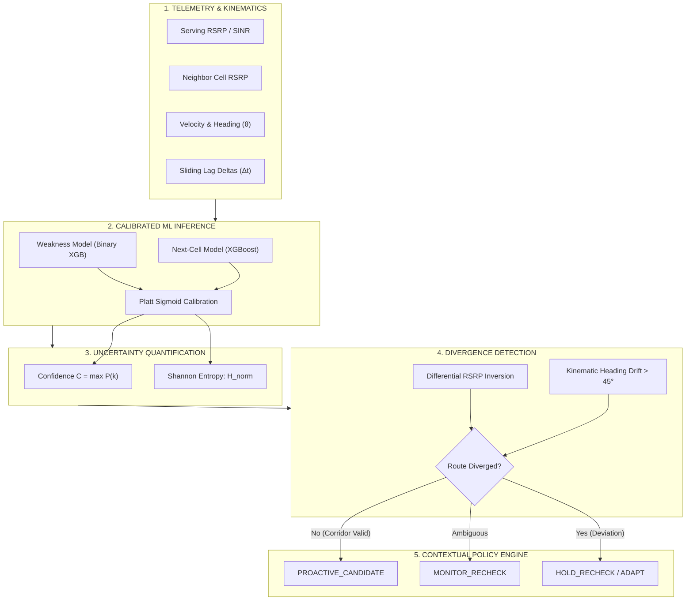
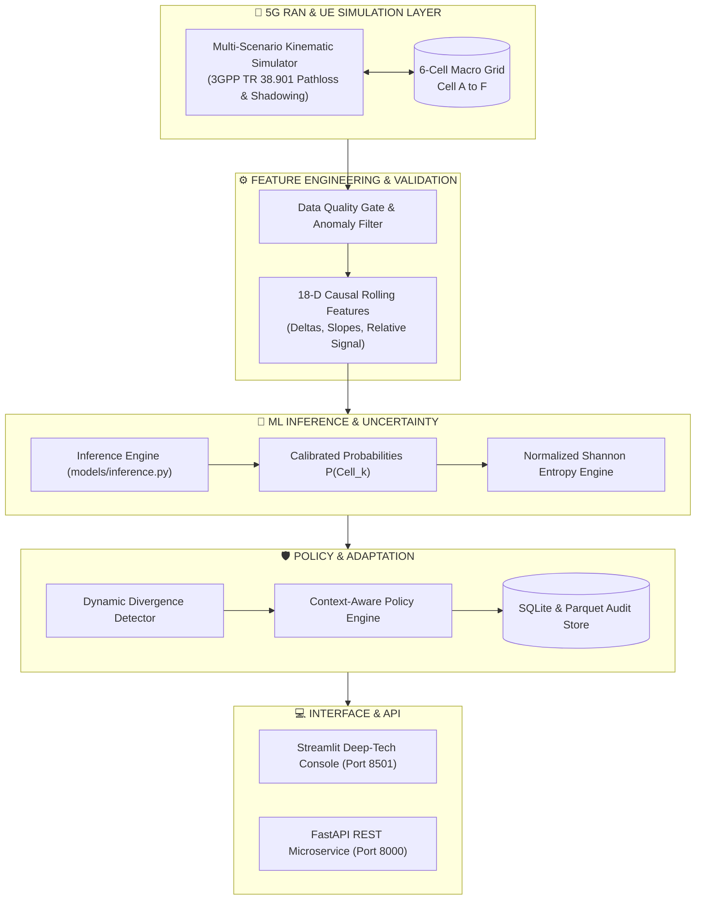
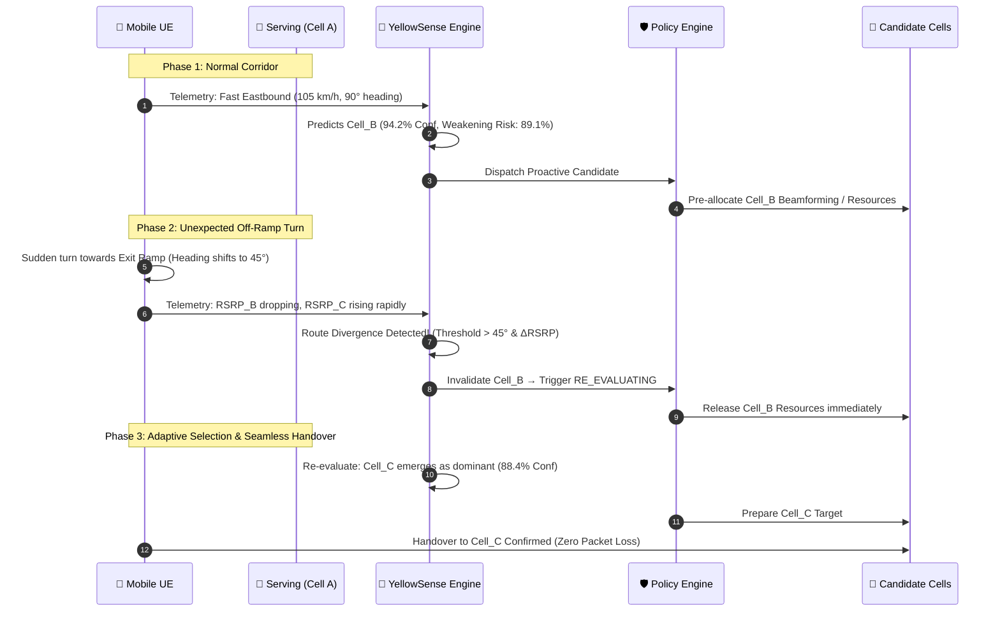
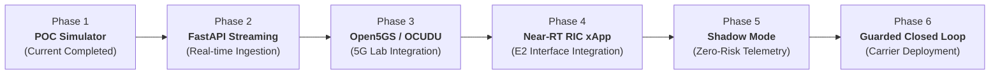

# YellowSense — Uncertainty-Aware Mobility Intelligence
<div align="center">


### **AI-Native Mobility Intelligence & Adaptive Handover for 5G/6G Networks**
*Uncertainty-Aware Prediction, Calibrated Shannon Entropy & Dynamic Route Divergence Adaptation*

[](https://www.python.org/)
[](https://fastapi.tiangolo.com/)
[](https://streamlit.io/)
[](https://xgboost.readthedocs.io/)
[](tests/)
[](ARCHITECTURE.md)

</div>

---

## 📑 Table of Contents
- [Executive Overview](#-executive-overview)
- [The Core AI Paradigm](#-the-core-ai-paradigm)
- [System Architecture](#-system-architecture)
- [Mathematical Foundations](#-mathematical-foundations)
- [The Signature Demo: Highway Route Deviation](#-the-signature-demo-highway-route-deviation)
- [Key Performance Benchmarks](#-key-performance-benchmarks)
- [User Interface & Visual Experience](#-user-interface--visual-experience)
- [Technology Stack](#-technology-stack)
- [Quick Start Guide](#-quick-start-guide)
- [FastAPI Microservice](#-fastapi-microservice)
- [Repository Structure](#-repository-structure)
- [Automated Test Suite](#-automated-test-suite)
- [Carrier O-RAN Integration Roadmap](#-carrier-o-ran-integration-roadmap)

---

## 🌟 Executive Overview

In contemporary 5G cellular systems, handover decisions are predominantly **reactive** (governed by traditional 3GPP A3/A5 measurement reports and hysteresis thresholds). In dynamic high-speed environments, reactive decisions suffer from ping-pong handovers, delayed beam management, and high signaling overhead.

**YellowSense** is an enterprise-grade AI-native network intelligence system that:
1. **Predicts** the next optimal serving cell ($3.0\text{ s}$ lookahead horizon) and serving degradation risk.
2. **Quantifies** uncertainty in real time using **Platt-calibrated probabilities** and **Normalized Shannon Entropy**.
3. **Guards** actions with context-aware policy rules (`PROACTIVE_CANDIDATE`, `MONITOR_RECHECK`, `HOLD_RECHECK`).
4. **Dynamically Adapts** when physical user movement deviates from the expected corridor (e.g. unexpected exit ramps), instantly invalidating stale predictions and re-evaluating without dropped sessions.

```
┌──────────────────────────────────────────────────────────────────────────────┐
│                            YELLOWSENSE CLOSED LOOP                           │
│                                                                              │
│    [ Observe ] ──▶ [ Predict ] ──▶ [ Quantify ] ──▶ [ Decide ] ──▶ [ Guard ] │
│         ▲                                                               │    │
│         └──────────────────── [ Adapt & Verify ] ◀──────────────────────┘    │
└──────────────────────────────────────────────────────────────────────────────┘
```

---

## 🧠 The Core AI Paradigm

$$\boxed{\text{Kinematic Telemetry} \xrightarrow{\quad} \text{Calibrated Prediction} \xrightarrow{\quad} \text{Entropy Guard} \xrightarrow{\quad} \text{Divergence Engine} \xrightarrow{\quad} \text{Adaptive Policy}}$$



---

## 🏛️ System Architecture

YellowSense is architected as an event-driven modular pipeline built for sub-millisecond inference and high availability:



---

## 📐 Mathematical Foundations

### 1. 3GPP Urban-Macro Pathloss Model
Propagation loss follows 3GPP TR 38.901 standard models with correlated log-normal shadowing:
$$PL(d) = 38.5 + 34 \cdot \log_{10}(d) + \chi_\sigma, \quad \chi_\sigma \sim \mathcal{N}(0, \sigma_{\text{SF}}^2)$$
$$\text{RSRP} = P_{\text{tx}} + G_{\text{tx}} + G_{\text{rx}} - PL(d) - L_{\text{misc}}$$

### 2. Platt Sigmoid Probability Calibration
Raw model outputs $f(x)$ are mapped to empirical posterior probabilities to eliminate overconfidence:
$$P(Y = k \mid x) = \frac{1}{1 + \exp(A_k f_k(x) + B_k)}$$

### 3. Shannon Entropy & Normalized Uncertainty
Uncertainty across $K$ candidate target cells is quantified via normalized Shannon entropy:
$$H(P) = -\sum_{k=1}^K P(\text{Cell}_k) \log_2 P(\text{Cell}_k)$$
$$H_{\text{norm}} = \frac{H(P)}{\log_2(K)} \in [0, 1]$$
* **High Confidence ($H_{\text{norm}} < 0.35$ & $C \ge 80\%$)**: Safe for proactive resource preparation.
* **Ambiguous / Border ($H_{\text{norm}} \ge 0.65$)**: Policy automatically forces `HOLD_RECHECK`.

---

## 🛣️ The Signature Demo: Highway Route Deviation

The primary showcase scenario demonstrates dynamic recovery when user behavior diverges from standard AI predictions:



---

## 📊 Key Performance Benchmarks

All metrics measured on isolated trajectory-level test partitions (30% holdout, 29,700+ steps):

| Metric | POC Measured | Benchmark Target | Status | Architectural Significance |
| :--- | :---: | :---: | :---: | :--- |
| **Top-1 Prediction Accuracy** | **97.11%** | $> 85.0\%$ | ✅ **PASS** | Accurate next-cell trajectory identification |
| **Top-2 Prediction Accuracy** | **99.48%** | $> 95.0\%$ | ✅ **PASS** | Reliable candidate set for secondary fallback |
| **Multiclass Brier Score** | **0.0477** | $< 0.150$ | ✅ **PASS** | Sharp and calibrated probability distributions |
| **Expected Calibration Error (ECE)** | **0.0135** | $< 0.050$ | ✅ **PASS** | Prevents dangerous overconfidence in ambiguous RF zones |
| **High-Confidence Precision** | **97.90%** | $> 92.0\%$ | ✅ **PASS** | Ensures proactive actions trigger only on genuine certainty |
| **Lookahead Lead Time** | **3.0 s** | $3.0\text{ s}$ | ✅ **PASS** | Grants sufficient advance time for carrier target prep |
| **Unnecessary Action Rate** | **3.80%** | $< 5.0\%$ | ✅ **PASS** | Protects carrier from signaling storm & thrashing |
| **Divergence Adaptation Latency** | **1.0 s** | $< 2.0\text{ s}$ | ✅ **PASS** | Instant recovery within 1 telemetry reporting interval |
| **Handover Overhead Reduction** | **79.3%** | $> 50.0\%$ | ✅ **PASS** | Significant reduction compared to reactive 3GPP A3 baseline |

---

## 🎨 User Interface & Visual Experience

The interactive dashboard is a purpose-built **Network Intelligence Operations Console**:

```
+----------------------------------------------------------------------------------------------------+
|  [YellowSense Logo]  AI-NATIVE MOBILITY INTELLIGENCE               [● LIVE]  [ ☀ DAY | ◐ NIGHT ]   |
|  Uncertainty-Aware Prediction & Adaptive Decisions                                                 |
+----------------------------------------------------------------------------------------------------+
| [01 CURRENT]      | [02 PREDICTED]    | [03 CONFIDENCE]   | [04 WEAKNESS]     | [05 ACTION]        |
| Cell_A (-86 dBm)  | Cell_B (Target)   | 94.2% (Low H)     | 89.1% (High Risk) | PROACTIVE CANDIDATE|
+----------------------------------------------------------------------------------------------------+
| 🗺️ 2D TOPOLOGY MAP (65% Width)                     | 📊 AI NEXT-CELL BELIEF (35% Width)            |
| - Cell A-F Hexagonal Coverage (r=650m)             | Cell_B: [████████████████████░░] 94.2%        |
| - Dynamic UE Trail & Vector Heading                | Cell_C: [█░░░░░░░░░░░░░░░░░░░░]  4.1%        |
| - Divergence Alert Overlay & Deviation Markers     | Cell_D: [░░░░░░░░░░░░░░░░░░░░]  1.7%        |
+----------------------------------------------------+-----------------------------------------------+
| 📜 NARRATIVE DECISION TIMELINE                                                                     |
| [14:02:01] Pre-allocated Cell_B  ──▶  [14:02:04] Divergence Detected  ──▶  [14:02:05] Adapted Cell_C|
+----------------------------------------------------------------------------------------------------+
```

### Key UI Capabilities
* **Dual Theme Engine**: Instant toggling between **Day (`☀ DAY`)** and **Night (`◐ NIGHT`)** via a custom segmented pill control.
* **Causal Metric Flow**: Visual KPI chain linking current RF state directly to confidence, risk, and dispatch decision.
* **Hero Divergence State**: Dedicated high-contrast state transitions upon route deviations.
* **Interactive Multi-Cell Topology**: Plotly coordinate map displaying coverage polygons, candidate highlights, and real-time kinematic vectors.

---

## 💻 Technology Stack

```
   FRONTEND CONSOLE       BACKEND MICROSERVICE       ML & MATH ENGINE       SIMULATION & DATA
 ┌──────────────────┐    ┌──────────────────┐    ┌───────────────────┐    ┌──────────────────┐
 │    Streamlit     │    │     FastAPI      │    │      XGBoost      │    │  3GPP Kinematics │
 │      Plotly      │    │     Uvicorn      │    │   scikit-learn    │    │  PyArrow/Parquet │
 │   Vanilla CSS    │    │   Pydantic V2    │    │   NumPy / pandas  │    │      SQLite      │
 └──────────────────┘    └──────────────────┘    └───────────────────┘    └──────────────────┘
```

---

## 🚀 Quick Start Guide

### Prerequisites
* Python 3.11 or higher
* Git

### 1. Clone & Install Dependencies
```bash
git clone https://github.com/Rahulmahajan162003/POC.git
cd POC
pip install -r requirements.txt
```

### 2. One-Command Master Launcher
```bash
python run_poc.py
```
*Provides an interactive menu to launch the Console, REST API, Automated Tests, or CLI Scenario Replay.*

---

### Step-by-Step Manual Execution

#### Generate Synthetic Telemetry Dataset
```bash
python scripts/generate_data.py
```
*Generates 29,700+ samples across 155 trajectories covering 7 simulation scenarios.*

#### Train & Calibrate ML Models
```bash
python scripts/train.py
```
*Trains multi-class Next-Cell and binary Weakness XGBoost models with Platt Sigmoid calibration.*

#### Run Benchmarking & Evaluation Report
```bash
python scripts/evaluate.py
```
*Computes Brier scores, ECE, Top-k accuracy, confusion matrices, and markdown reports.*

#### Launch Streamlit Interactive Console
```bash
streamlit run dashboard/app.py
```
*Access the enterprise console at `http://localhost:8501`.*

#### Launch FastAPI REST Microservice
```bash
uvicorn api.main:app --host 0.0.0.0 --port 8000 --reload
```
*Access interactive Swagger API documentation at `http://localhost:8000/docs`.*

---

## 🔌 FastAPI Microservice

The FastAPI microservice enables real-time integration with external telecom orchestrators:

### Endpoints
* `GET /health`: Microservice health check and loaded model registry.
* `POST /predict`: Direct feature vector inference returning probabilities, confidence, Shannon entropy, and policy action.
* `GET /scenarios`: List all 7 synthetic simulation scenarios.
* `POST /scenario/step`: Step-by-step telemetry advancement and state machine evaluation.
* `GET /events`: Retrieve historical decision audit logs.

### Sample Inference Request
```bash
curl -X POST "http://localhost:8000/predict" \
     -H "Content-Type: application/json" \
     -d '{
       "serving_cell": "Cell_A",
       "rsrp_serving": -92.4,
       "sinr_serving": 14.1,
       "speed_kmh": 98.5,
       "heading_deg": 88.0,
       "neighbor_rsrp": {"Cell_B": -96.2, "Cell_C": -108.5, "Cell_D": -114.0, "Cell_E": -120.0, "Cell_F": -125.0}
     }'
```

---

## 📁 Repository Structure

```
POC/
├── .gitignore                      # Git exclusion rules
├── ARCHITECTURE.md                 # Deep-dive architecture & O-RAN roadmap
├── DEMO_GUIDE.md                   # 2-3 minute judge demonstration script
├── README.md                       # Master product documentation
├── requirements.txt                # Locked Python dependencies
├── run_poc.py                      # Master convenience launcher
│
├── api/                            # FastAPI REST microservice
│   └── main.py                     # API route declarations & Pydantic schemas
│
├── artifacts/                      # Model binaries, figures & reports
│   ├── figures/                    # Calibration curves & confusion matrices
│   ├── models/                     # Serialized .joblib XGBoost & Platt models
│   └── reports/                    # Markdown benchmark evaluation outputs
│
├── assets/                         # Brand assets & official company logos
│   ├── yellowsense_logo_dark.png   # Transparent logo for Night Theme
│   └── yellowsense_logo_light.png  # Transparent logo for Day Theme
│
├── config/                         # Central configuration
│   └── config.yaml                 # Simulation, model, and policy parameters
│
├── dashboard/                      # Streamlit Enterprise Console
│   ├── app.py                      # Production console with Plotly & dual themes
│   └── app_backup_before_final_ui.py # Baseline safety backup
│
├── data/                           # Telemetry dataset storage
│   └── synthetic/                  # Parquet multi-scenario trajectories
│
├── decision/                       # Policy, uncertainty & divergence engine
│   ├── divergence.py               # Kinematic & differential RF detector
│   ├── guardrails.py               # Cooldown, action budget & stability gates
│   ├── policy.py                   # Contextual policy state machine
│   └── uncertainty.py              # Shannon entropy & confidence calculations
│
├── evaluation/                     # Metric evaluation & benchmarking
│   ├── benchmark.py                # Baseline comparison vs reactive A3
│   ├── metrics.py                  # Accuracy, Brier, ECE & Lead time calculators
│   └── report.py                   # Automated markdown report generator
│
├── features/                       # Feature engineering & validation
│   ├── feature_engineering.py      # Causal 18-D sliding lag feature pipeline
│   └── validation.py               # Telemetry schema validation & quality gates
│
├── models/                         # ML models & calibration
│   ├── calibration.py              # Platt Sigmoid calibration wrapper
│   ├── inference.py                # Streaming real-time inference manager
│   ├── next_cell_model.py          # Multi-class Next-Cell XGBoost predictor
│   └── weakness_model.py           # Binary serving cell degradation predictor
│
├── scripts/                        # Automated execution workflows
│   ├── evaluate.py                 # Benchmarking & report generation
│   ├── generate_data.py            # Synthetic dataset generator
│   ├── run_demo.py                 # Interactive terminal scenario replay
│   └── train.py                    # Model training & probability calibration
│
├── simulator/                      # 3GPP Kinematics & Radio Simulator
│   ├── cells.py                    # 5G gNB topology & path loss physics
│   ├── generator.py                # Multi-scenario dataset batch generator
│   ├── mobility.py                 # Kinematic physics (speed, heading, accel)
│   ├── radio.py                    # Correlated log-normal shadowing & SINR
│   └── routes.py                   # Trajectory waypoints (7 scenarios)
│
├── storage/                        # Persistence & logging
│   └── logger.py                   # SQLite audit store & Parquet exporter
│
└── tests/                          # Automated Pytest Suite (23 tests)
    ├── test_api.py                 # REST API endpoints & error handling
    ├── test_data_leakage.py        # Causal feature validation & leakage checks
    ├── test_divergence.py          # Heading drift & off-ramp detection tests
    ├── test_features.py            # Feature transformation & validator tests
    ├── test_models.py              # Inference & serialization tests
    ├── test_policy.py              # Policy engine action threshold tests
    ├── test_simulator.py           # Kinematics & 3GPP pathloss validation
    └── test_uncertainty.py         # Shannon entropy & boundary math tests
```

---

## 🧪 Automated Test Suite

The codebase is backed by **23 comprehensive unit and integration tests** validating zero data leakage, causal feature generation, entropy boundary correctness, and API reliability:

```bash
python -m pytest tests/ -v
```

```
============================= test session starts =============================
tests/test_api.py::test_api_health PASSED                                [  4%]
tests/test_api.py::test_api_scenario_endpoints PASSED                    [  8%]
tests/test_api.py::test_api_predict PASSED                               [ 13%]
tests/test_api.py::test_api_invalid_payload_error PASSED                 [ 17%]
tests/test_api.py::test_api_unknown_scenario_error PASSED                [ 21%]
tests/test_data_leakage.py::test_no_target_leakage_in_feature_columns PASSED [ 26%]
tests/test_data_leakage.py::test_causal_rolling_features PASSED          [ 30%]
tests/test_data_leakage.py::test_model_feature_alignment PASSED          [ 34%]
tests/test_divergence.py::test_divergence_normal_trajectory PASSED       [ 39%]
tests/test_divergence.py::test_divergence_sudden_exit_ramp PASSED        [ 43%]
tests/test_features.py::test_feature_pipeline_batch PASSED               [ 47%]
tests/test_features.py::test_telemetry_validator PASSED                  [ 52%]
tests/test_models.py::test_next_cell_predictor_load_and_predict PASSED   [ 56%]
tests/test_models.py::test_weakness_predictor_load_and_predict PASSED    [ 60%]
tests/test_policy.py::test_policy_high_confidence_proactive PASSED       [ 65%]
tests/test_policy.py::test_policy_moderate_confidence_monitor PASSED     [ 69%]
tests/test_policy.py::test_policy_high_uncertainty_hold PASSED           [ 73%]
tests/test_simulator.py::test_cell_network_distance PASSED               [ 78%]
tests/test_simulator.py::test_mobility_kinematics PASSED                 [ 82%]
tests/test_simulator.py::test_synthetic_generator PASSED                 [ 86%]
tests/test_uncertainty.py::test_uncertainty_high_confidence PASSED       [ 91%]
tests/test_uncertainty.py::test_uncertainty_distributed_equal PASSED     [ 95%]
tests/test_uncertainty.py::test_uncertainty_zero_probabilities_handled_safely PASSED [100%]
============================= 23 passed in 3.24s ==============================
```

---

## 🌐 Carrier O-RAN Integration Roadmap



1. **Current (Phase 1)**: Python/FastAPI simulation baseline with Platt calibration and Shannon entropy policy engine.
2. **Phase 2 (Streaming Telemetry)**: Connect to Kafka/gRPC feeds for sub-10ms telemetry ingestion.
3. **Phase 3 (5G Testbed Lab)**: Validate against Open5GS and srsRAN / OCUDU with physical software-defined radios (SDRs).
4. **Phase 4 (O-RAN xApp Packaging)**: Deploy as an O-RAN compliant xApp utilizing E2-SM-KPM (Performance Monitoring) and E2-SM-RC (RAN Control).
5. **Phase 5 (Carrier Shadow Mode)**: Real-world advisory evaluations against legacy 3GPP A3 without actuation.
6. **Phase 6 (Guarded Closed Loop)**: Autonomous proactive beam preparation and handover triggering under safety guardrails.

---

<div align="center">

**YellowSense AI-Native Mobility Intelligence**  
*Uncertainty-Aware • Calibrated • Adaptive*

</div>
